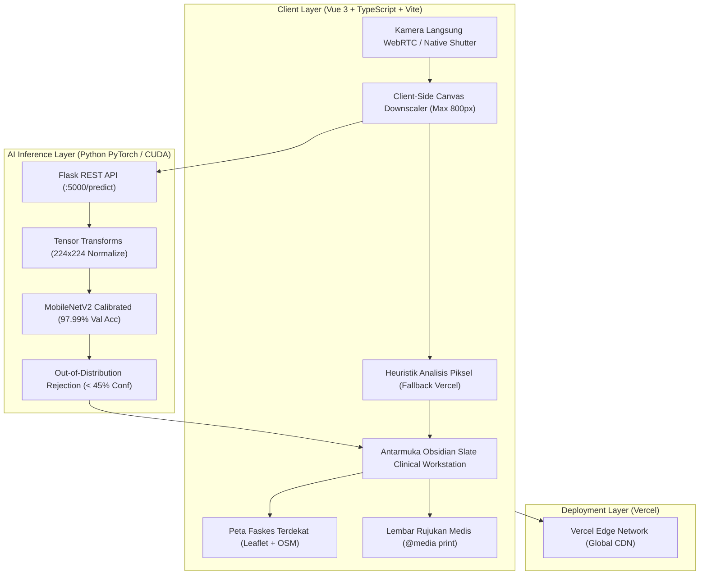

# 👁️ SOCA — Smart Ocular Condition Analyzer

[](https://github.com/luminariadev/soca/actions/workflows/ci.yml)
[](LICENSE)
[](https://vuejs.org/)
[](https://vitejs.dev/)
[](https://www.typescriptlang.org/)
[](https://tailwindcss.com/)
[](https://pytorch.org/)
[](https://vercel.com/)
[](https://www.docker.com/)

**SOCA (Smart Ocular Condition Analyzer)** adalah platform skrining klinis cerdas non-invasif untuk deteksi dini anomali pada **mata bagian luar (anterior eye: kornea, pupil, sklera, dan palpebra)** secara *real-time* via kamera laptop maupun ponsel pintar tanpa radiasi retina.

Platform ini memadukan arsitektur visi komputer terkalibrasi **MobileNetV2** (akurasi validasi **97.99%** dan F1-Score **0.98** pada 3.988 citra klinis) dengan antarmuka klinis modern berbasis **Vue 3, TypeScript, Tailwind CSS, dan Leaflet OpenStreetMap**.

---

## 🔬 Cakupan Diagnosis 7 Kondisi Mata Anterior

SOCA dirancang khusus untuk struktur biologis mata bagian luar (*non-retinal*), mematuhi standar klasifikasi medis internasional **ICD-10**:

| No | Kondisi Mata | Kode ICD-10 | Target Anatomis | Kategori Klinis | Tingkat Keparahan |
| :-: | :--- | :---: | :--- | :--- | :---: |
| 1 | **Normal (Mata Sehat)** | `Z01.00` | Kornea jernih, sklera putih, pupil sentral | Fisiologis Sehat | Aman / Normal |
| 2 | **Konjungtivitis (Mata Merah)** | `H10.9` | Sklera & selaput konjungtiva bulbi | Inflamasi Sklera | Sedang |
| 3 | **Katarak Eksternal** | `H26.9` | Kekeruhan lensa kristalin pupil | Kekeruhan Lensa | Perlu Penanganan Cepat |
| 4 | **Bulging Eyes (Proptosis)** | `H05.20` | Penonjolan bola mata & periorbital | Anomali Tiroid / Orbita | Sedang |
| 5 | **Crossed Eyes (Strabismus)** | `H49.9` | Ketidaksejajaran sumbu visual | Deviasi Sumbu Bola Mata | Ringan |
| 6 | **Dark Circles + Eyebags** | `L81.8` | Sirkulasi & vaskularisasi infraorbital | Estetika & Sirkulasi | Ringan |
| 7 | **Kelainan Kelopak Mata (Eyelid)** | `H01.0` | Palpebra, silia & kelenjar meibom | Blefaritis & Hordeolum | Sedang |

---

## 🏛️ Arsitektur Sistem



---

## ✨ Fitur Unggulan

1. **Dual-Engine Inference (PyTorch GPU + Fallback Client-Side)**:
   - Didukung backend PyTorch GPU berlatensi rendah (< 20 ms).
   - Dilengkapi *client-side pixel analyzer* independen sehingga aplikasi dapat berjalan 100% *standalone* saat dideploy di serverless Vercel tanpa backend Python.
2. **Kompresi Citra Otomatis (*Anti-Crash LMK*)**:
   - Foto resolusi tinggi (12 MP – 50 MP) dari ponsel otomatis diperkecil ke 800px (~80 KB) di memori kanvas sebelum inferensi, mencegah *browser tab reload* akibat *Low-Memory Killer* di HP.
3. **Peta Faskes & Dokter Spesialis Mata Nyata**:
   - Integrasi **Leaflet.js & OpenStreetMap** interaktif untuk menemukan rumah sakit mata terdekat di seluruh Indonesia (Jabodetabek, Jawa Barat, Jawa Tengah, Jawa Timur, Bali, Sumatera, dan Sulawesi).
4. **Cetak Lembar Rujukan Medis Resmi (*Print-Ready*)**:
   - Template rujukan rumah sakit otomatis siap cetak PDF dengan format dokumen resmi (identitas skrining, kode ICD-10, anamnesis, matriks probabilitas 7 kelas, dan paraf pemeriksa).
5. **Atlas & Ensiklopedia Klinis**:
   - Panduan edukasi kesehatan mata lengkap dengan foto slit-lamp mikroskopis asli, indikator *Red Flags*, serta panduan perawatan mandiri berbasis bukti.
6. **Mobile Ergonomics (iOS-Style Liquid Dock & Bottom Sheets)**:
   - Navigasi mengambang *liquid-glass* ala Apple iOS dengan modal info/riwayat berformat *bottom-sheet* yang ramah jangkauan jempol satu tangan.

---

## 🛠️ Tech Stack

### Frontend
- **Framework:** [Vue 3](https://vuejs.org/) (Composition API, `<script setup lang="ts">`)
- **Language:** [TypeScript 5](https://www.typescriptlang.org/)
- **Bundler:** [Vite 8](https://vitejs.dev/)
- **Styling:** [Tailwind CSS 3.4](https://tailwindcss.com/)
- **GIS / Mapping:** [Leaflet.js](https://leafletjs.com/) + OpenStreetMap
- **Typography & Icons:** Inter, JetBrains Mono, Google Material Symbols

### Backend
- **Framework:** [Flask](https://flask.palletsprojects.com/) + Flask-CORS
- **Deep Learning:** [PyTorch 2.5](https://pytorch.org/) (CUDA 12.1 / CPU) + Torchvision
- **Arsitektur Model:** MobileNetV2 (Transfer Learning, Dropout 0.3, Dense 256, Softmax 7-Class)
- **Image Processing:** Pillow (PIL), NumPy

---

## 🚀 Panduan Memulai Cepat (Local Development)

### 1. Prasyarat
- [Node.js](https://nodejs.org/) v18+ atau v20+
- [Python](https://www.python.org/) 3.9+ atau 3.10+
- [Git](https://git-scm.com/)

### 2. Kloning Repositori
```bash
git clone https://github.com/luminariadev/soca.git
cd soca
```

### 3. Menjalankan Frontend
```bash
cd frontend
npm install
npm run dev -- --host 0.0.0.0 --port 5173
```
Frontend siap diakses di:
- **Lokal:** `http://localhost:5173/`
- **Jaringan Wi-Fi (Ponsel):** `http://<IP-Lokal-Anda>:5173/`

### 4. Menjalankan Backend PyTorch (Opsional untuk GPU Inference)
```bash
cd ../backend
pip install -r requirements.txt
python server.py
```
Backend API aktif di: `http://localhost:5000/` (Health check: `http://localhost:5000/health`).

---

## 🐳 Menjalankan via Docker Compose

Untuk menjalankan seluruh ekosistem (Frontend + Backend) dalam kontainer terisolasi:

```bash
docker compose up --build
```
- **Aplikasi Web:** `http://localhost`
- **Backend API:** `http://localhost:5000`

---

## 🌐 Panduan Deployment Vercel

Frontend SOCA telah dikonfigurasi untuk deployment instan *zero-config* di Vercel:

1. Buka [Vercel Dashboard](https://vercel.com/) dan masuk menggunakan akun GitHub Anda (`rizkianuari83@gmail.com`).
2. Klik **Add New Project** $\rightarrow$ Impor repositori **`luminariadev/soca`**.
3. Di pengaturan proyek:
   - **Framework Preset:** Vite
   - **Root Directory:** `frontend` *(atau biarkan root jika menggunakan vercel.json bawaan)*
   - **Build Command:** `npm run build`
   - **Output Directory:** `dist`
4. Klik **Deploy**. Web akan live dalam hitungan detik!

---

## ⚖️ Clinical & Medical Disclaimer

> [!WARNING]
> **SOCA (Smart Ocular Condition Analyzer)** adalah instrumen penunjang skrining awal berbasis visi komputer dan **BUKAN** pengganti diagnosis definitif, evaluasi klinis langsung, atau resep pengobatan oleh dokter spesialis mata (*Ophthalmologist* / Sp.M).
> 
> Selalu konsultasikan keluhan mata yang Anda alami kepada dokter atau fasilitas kesehatan berwenang, terutama bila disertai tanda kegawatdaruratan (*red flags*) seperti nyeri hebat, penurunan tajam penglihatan mendadak, atau trauma bola mata.

---

## 👨‍💻 Pengembang (Author)

**Rizkia Nuari Fujiana**  
*Fullstack & AI Engineer*  
- **GitHub:** [@luminariadev](https://github.com/luminariadev)
- **Portofolio:** [rizkianuari.vercel.app](https://rizkianuari.vercel.app/)

---

## 📄 Lisensi

Proyek ini dilisensikan di bawah [MIT License](LICENSE) © 2026 Rizkia Nuari Fujiana.
